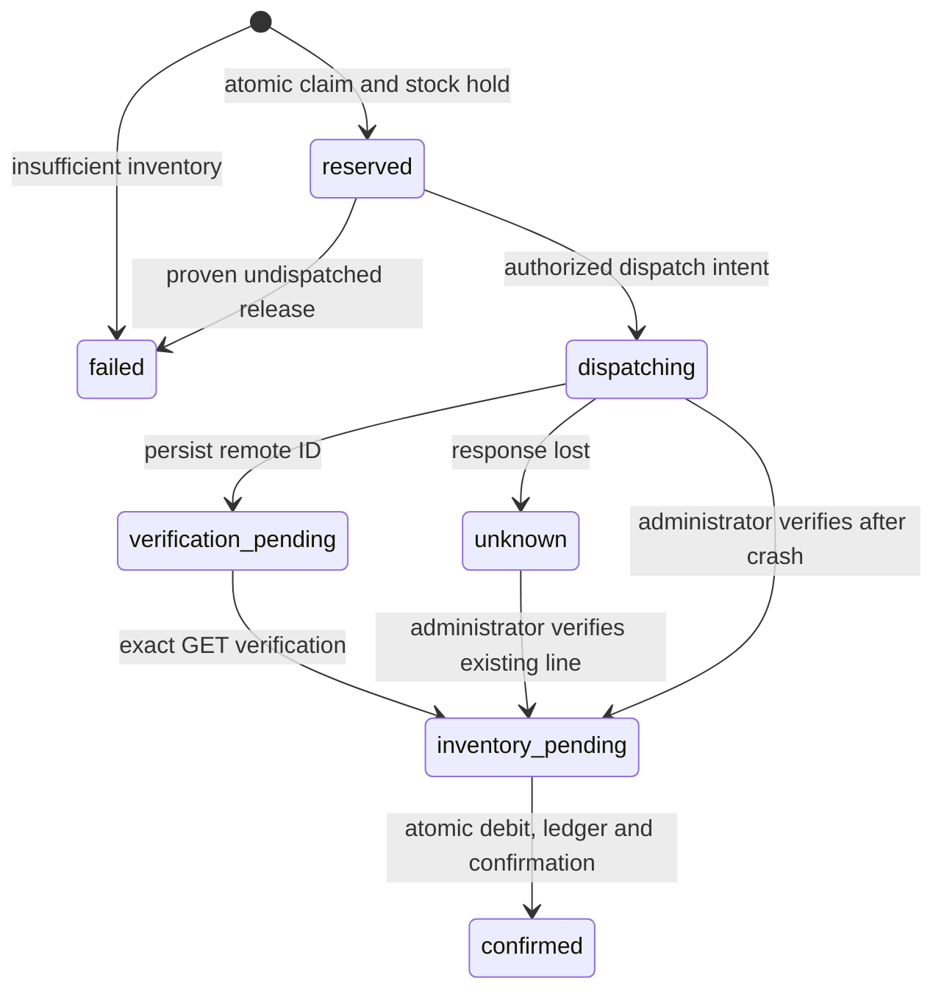

# Phase 1 schema and transaction model

Three ordered migrations create structure and permissions only. No users,
customer accounts, inventory, keys or live connections are seeded.

| Table | Purpose and constraints |
| --- | --- |
| `public.hq_accounts` | Tenant; materials disabled by default; account-bound active connection pointer. |
| `public.hq_users` | Profile linked to `auth.users`; disabled users lose authorization. |
| `public.hq_memberships` | Account/user key; active owner/admin/technician/viewer role. |
| `public.hq_platform_connections` | Platform/company/version binding; at most one active connection per account; operational accounts require one. Active external companies cannot belong to two HQ accounts. |
| `public.hq_catalog_parts` | Account-unique SKU, name, authoritative integer-cent sale price, taxability and active flag. |
| `public.hq_inventory_locations` | Account-scoped location; one assigned location/van per technician in Phase 1. |
| `public.hq_inventory_balances` | Account/location/part key; nonnegative quantities; reserved cannot exceed on-hand. |
| `public.hq_inventory_ledger` | Append-only movement; unique account/submission/action prevents repeat debit. |
| `public.hq_audit_records` | Append-only tenant audit; no keys or raw upstream errors; administrator-readable. |
| `hq_private.credential_secrets` | Account ownership of a Vault UUID. |
| `hq_private.connection_credentials` | Account/connection-to-Vault UUID binding; composite ownership foreign keys; no plaintext column. |
| `hq_private.part_costs` | Private cost and optional platform pricebook reference. |
| `hq_private.job_confirmations` | Account/user/connection version, exact job ID/number and expiration. |
| `hq_private.material_quotes` | Bound confirmation, selected material and expiration; JSON plus original serialization. |
| `hq_private.material_submissions` | Durable account-unique request key and SHA-256 fingerprint; owner, job, connection version, payload, state, dispatch timestamp and remote ID. Remote ID unique per account/connection. |
| `hq_private.inventory_reservations` | One hold per submission; positive quantity and held/committed/released state. |

Every HQ table enables and forces RLS. Clients have tenant-filtered public-table
reads and no direct writes. Private tables have no client grants. Profiles are
self-readable; memberships self/admin-readable; audit records admin-readable.
Catalog, stock and ledger reads are available to active account members;
account-wide stock visibility is deliberate.

`public.hq_backend(actor,account,operation,args)` is service-role-only. The Edge
Function obtains actor identity with Supabase Auth `getUser(token)`. SQL checks
current account membership, disabled flags and roles. PINs and JWT metadata roles
do not authorize operations. Because privileged RPC bypasses client RLS, these
explicit checks are part of the isolation boundary. Never expose its server key.

| Action | Owner/admin | Technician | Viewer |
| --- | --- | --- | --- |
| Read jobs/status | Yes | Yes | Yes |
| Quote/create/recover own submission | Yes | Yes | No |
| Configure connection/reconcile | Yes | No | No |
| Browser writes/private secrets | No | No | No |

Server-only, owner-bound completion of an already dispatched transaction may
finish after mid-request revocation. New requests and dispatches require current
authorization. HCP credentials are decrypted only by the server-only RPC.

## Transaction states

Mutations lock account first, then connection/submission, then stock. Claim,
reservation and audit are atomic. Final stock debit, reservation commit, unique
ledger entry, confirmed result and audit are a second atomic SQL transaction.
Account serialization is conservative and may limit large-account throughput.

HCP POST is outside the database transaction. Dispatch intent precedes POST;
remote ID persistence precedes GET read-back. The service never automatically
repeats an ambiguous POST. A crashed `dispatching` row remains uncertain.
Administrator reconciliation can adopt a verified existing line ID or release
a provably undispatched hold. Absence from a GET is insufficient to release a
possibly dispatched hold. Local durable idempotency does not promise distributed
exactly-once HCP delivery; a lost remote ID can require operator investigation.

Unresolved submissions block connection changes. SKU, sale price, internal cost,
taxability and references are server-owned and rechecked at claim and dispatch.
Read-back verifies company/job, unique line ID, kind, name/description, quantity,
price/cost, taxability and any pricebook reference before inventory confirmation.

This creates a billable `materials` job line, not a job-cost input. The official
POST contract is retained in `../official-contract.json` and `../REQUIREMENTS.md`.
Read-back uses `GET /jobs/{job_id}/line_items` and its `data` array.
